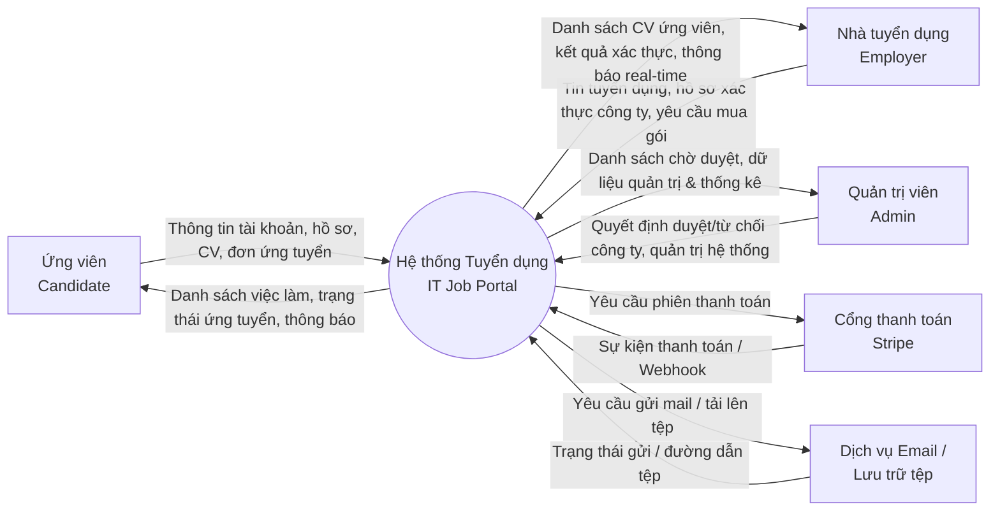

# Context Diagram — IT Job Portal

Sơ đồ ngữ cảnh (System Context Diagram) mô tả ranh giới hệ thống **IT Job Portal** cùng các tác nhân người dùng (Actors) và các hệ thống bên ngoài (External Systems) tương tác với hệ thống.

