# Sequence Diagrams (Các luồng quan trọng nhất) — IT Job Portal

Tài liệu tổng hợp các lược đồ tuần tự (Sequence Diagram) tách riêng cho từng chức năng quan trọng trong hệ thống **IT Job Portal**.

---

## 1. Đăng ký tài khoản (UC-01)

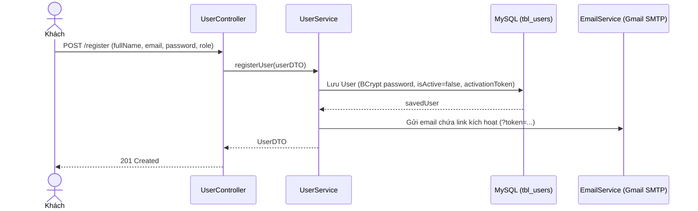

---

## 2. Kích hoạt tài khoản (UC-02)

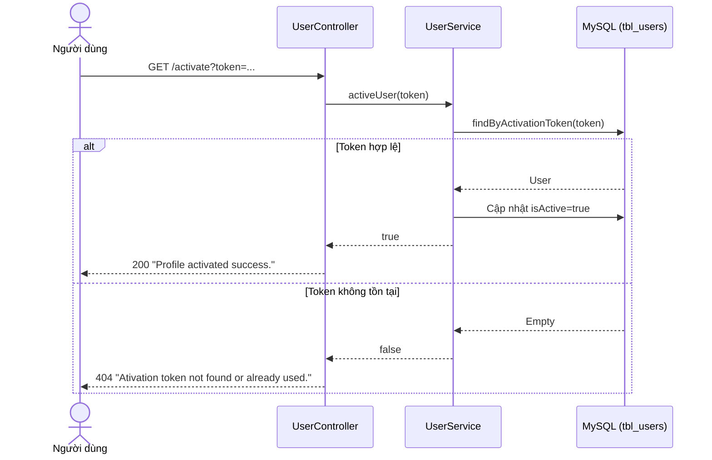

---

## 3. Đăng nhập (UC-03)

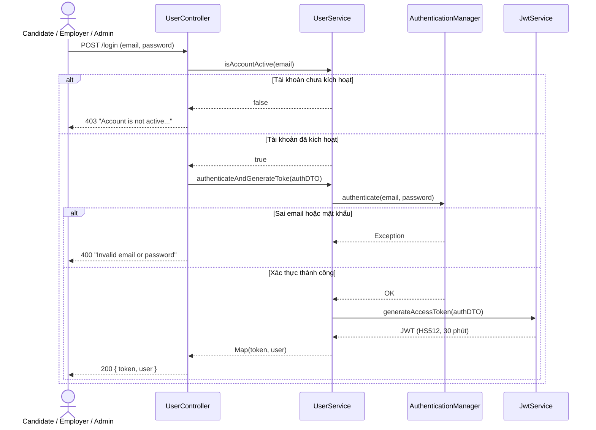

---

## 4. Tạo công ty (UC-05)

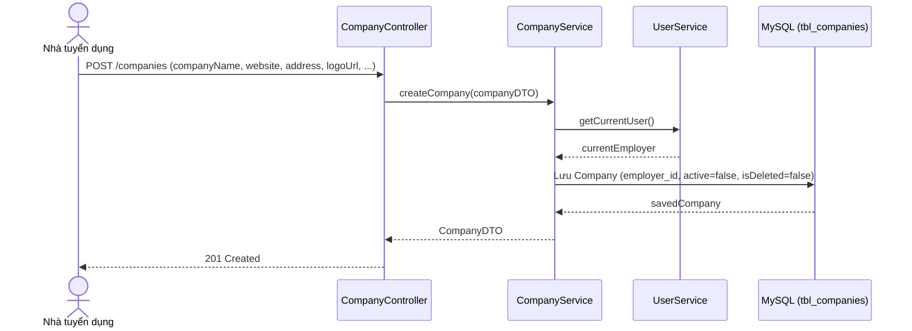

---

## 5. Employer nộp hồ sơ xác thực Công ty (UC-08)

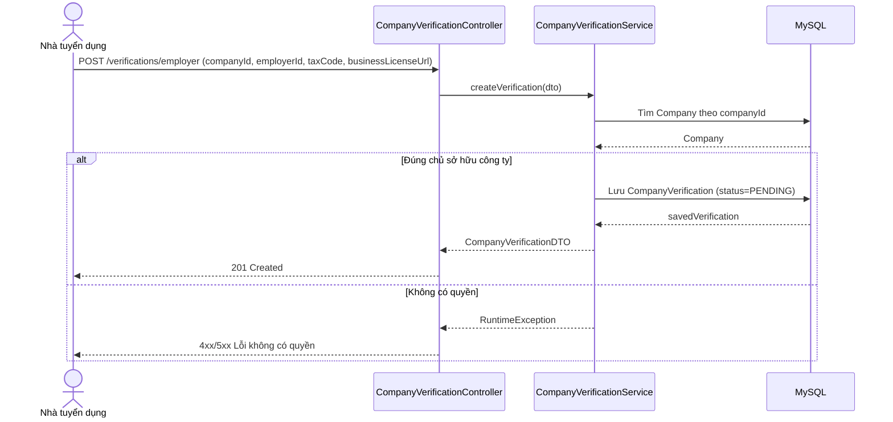

---

## 6. Admin duyệt xác thực Công ty & Thông báo Realtime (UC-09, UC-24)

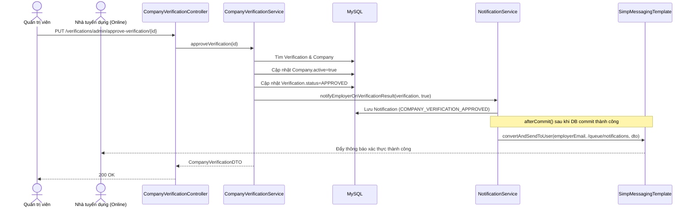

---

## 7. Admin từ chối xác thực Công ty & Thông báo Realtime (UC-10, UC-24)

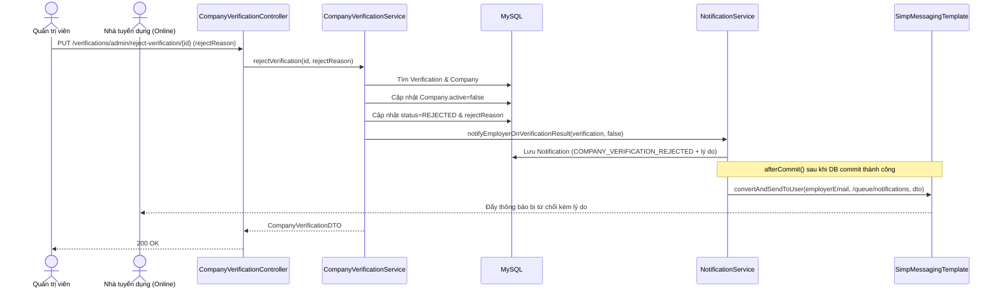

---

## 8. Tạo Job tuyển dụng (UC-11)

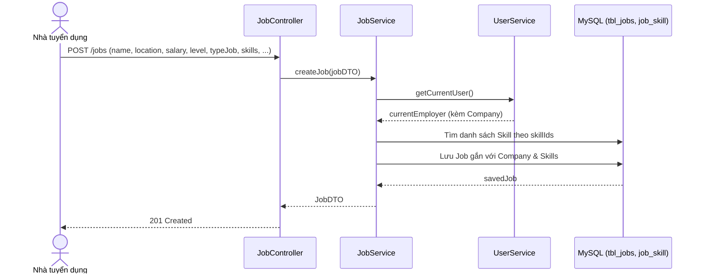

---

## 9. Cập nhật Job tuyển dụng (UC-12)

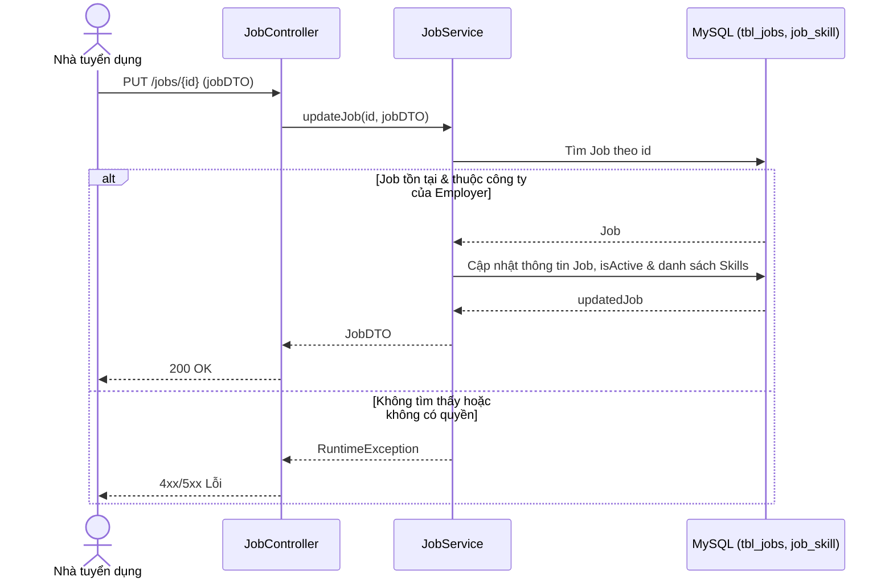

---

## 10. Ứng viên ứng tuyển Job & Thông báo Realtime (UC-17, UC-24)

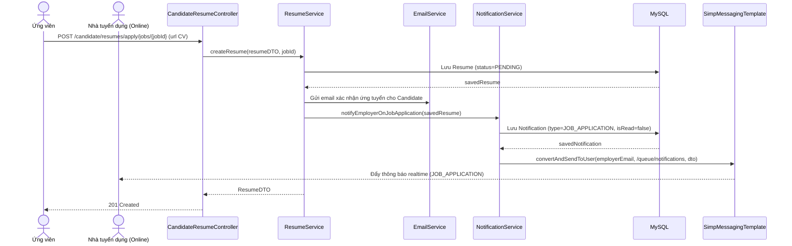

---

## 11. Mua gói điểm qua Stripe Checkout (UC-20)

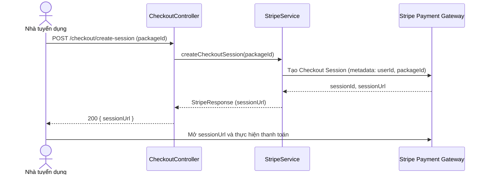

---

## 12. Xử lý Stripe Webhook cộng điểm (UC-21)

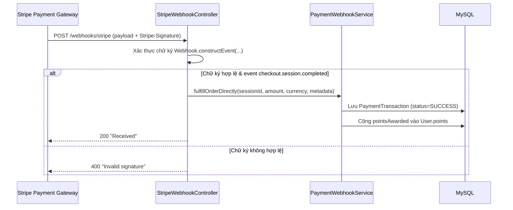

---

## 13. Mở khóa hồ sơ Ứng viên (UC-22)

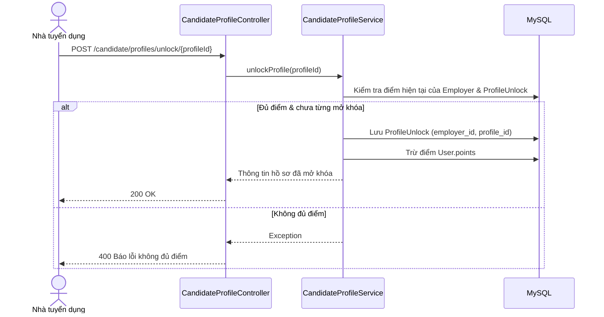

---

## 14. Admin đăng bài Blog mới (UC-27)

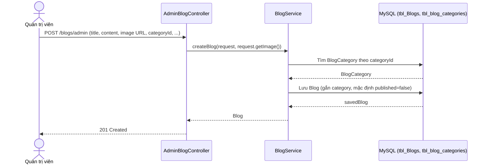

---

## 15. Admin Public / Unpublish bài Blog (UC-27)

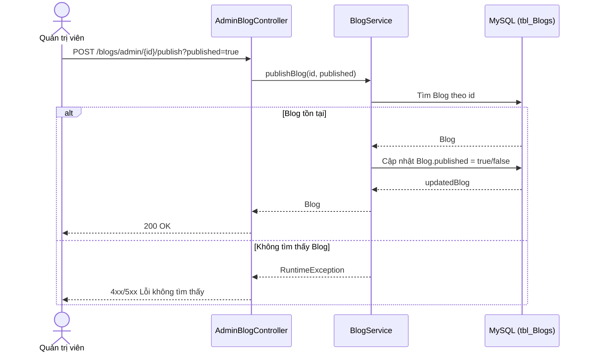

---

## 16. Xem danh sách Thông báo & Số lượng chưa đọc (UC-25)

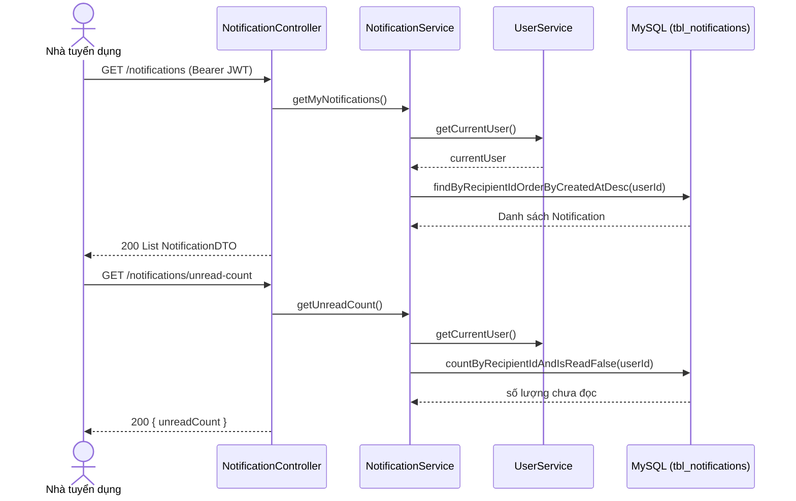

---

## 17. Đánh dấu đã đọc 1 Thông báo (UC-25)

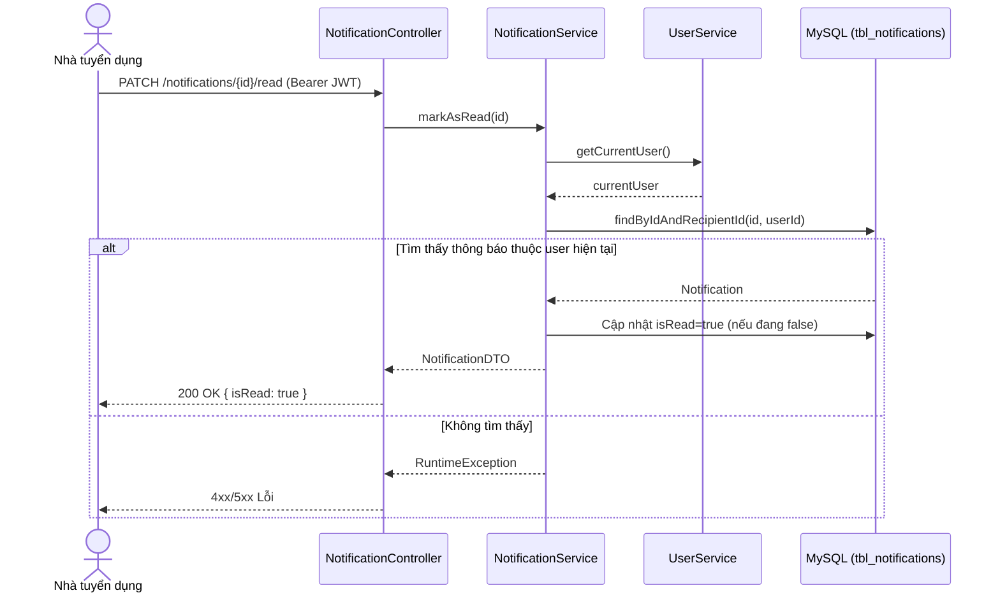

---

## 18. Đánh dấu tất cả Thông báo đã đọc (UC-25)

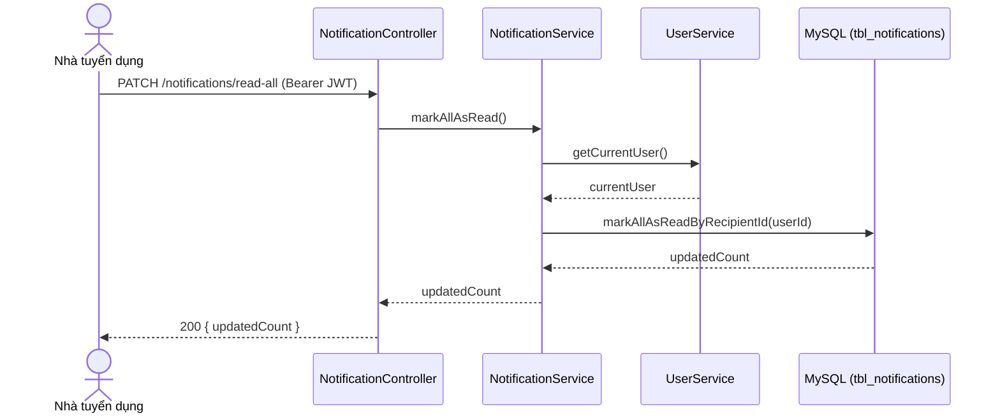
